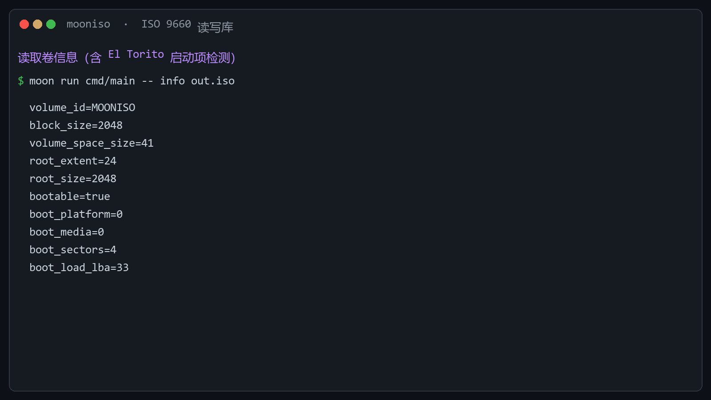

# mooniso

纯 MoonBit 的 ISO 9660（ECMA-119）光盘映像读写库。读一张光盘、造一张光盘，都不需要 FFI、不需要 root、不需要系统装 7-Zip。

现成的路线只有两条：挂 C 库或调 `mount`/`isoinfo`——wasm-gc 下不成立、CI 里要提权；或者移植 libcdio 一类 LGPL 实现——许可传染。本条路线是自己按规范解析字节，第三方实现只在测试期当判据。

## 覆盖范围

| 规范 | 读 | 写 | 独立判据 |
|---|---|---|---|
| ECMA-119（ISO 9660） | 卷描述符链、目录记录、多段文件、路径解析、文件读取、L/M 路径表 | 名字级别 1/2/3、目录记录、L/M 路径表、块分配 | pycdlib、Linux 内核 isofs、Windows CDFS |
| Joliet | 补充卷描述符、UCS-2 名字（含代理对） | 完整目录树 + UCS-2 路径表 | pycdlib、Windows 挂载 |
| IEEE P1282（SUSP / Rock Ridge） | SP / ER / RR / NM / PX / SL / CE | NM / PX / SL / TF，1.09 与 1.12 两版 | pycdlib |
| El Torito | 启动目录、默认启动项、UEFI section header | 启动记录卷描述符 + 启动目录（BIOS 与 UEFI 双启动；支持多启动 section），可选 boot info table（`--boot-info-table`，供 syslinux/isolinux） | pycdlib、mkisofs 约定 |
| ECMA-167（UDF） | **UDF 1.02 单分区只读完整读取**：Anchor → 描述符序列 → File Set → File Entry / 间接条目 / 分配扩展 → FID；64 位文件长度；映像经 `ImageSource` 按 2048 字节块读取，**不必整张进内存** | —（只读） | pycdlib 的 UDF 视角 |

条款级的「实现文件 / 判别用例 / 判据」三列对照见 [docs/conformance.md](docs/conformance.md)。

## 安装与最小示例

```bash
moon add LL728/mooniso
```

```moonbit
// 读一张映像（bytes 由调用方提供，例如 @fs.read_file_to_bytes(path)）
let image = @mooniso.IsoImage::open(bytes)
println(image.volume_id())                 // 卷标
for entry in image.walk("/") {             // 递归列树
  println("\{entry.path}\t\{entry.size}")
}
let data = image.read_file("/HELLO.TXT")   // 取内容（多段、跨扇区、越界拒绝）

// 区间读取：只取大文件的一段，避免整块拷贝
let head = image.read_range("/BIG.BIN", 0, 4096)

// 造一张映像
let builder = @mooniso.IsoBuilder::new()
builder.add_directory("/Docs")
builder.add_file("/Docs/note.md", @utf8.encode("# note"))  // 内容需为 Bytes
builder.add_symlink("/link.txt", "/Docs/note.md")
let image_bytes = builder.build()           // -> Bytes
```

（`@utf8` 来自 `moonbitlang/core/encoding/utf8`，需在 `moon.pkg` 中 import；上例的可编译等价版本见 `examples/readme_demo`。）

仓库内可直接跑的示例（造映像 → 读回 → 列树 → 结构体检）：

```bash
moon run examples/roundtrip
```

包结构：`LL728/mooniso` 是对外门面（只转出类型），实现全在 `LL728/mooniso/impl`——
字节序、卷描述符、目录记录、SUSP、El Torito、UDF、写入器各一块。底层解析函数留在实现包里，不作为接口承诺。

## 大映像：数据源与 64 位寻址（0.7.0 起提供）

`Bytes` 的索引是 32 位，单块内存上限约 2 GiB；而 UDF 1.02 的映像与其中的文件都允许 64 位长度。
若解析器要求先 `open(data : Bytes)` 把整张映像装进内存，6 GiB 的映像就永远进不了解析器——
只把输出改成区间读取，绕不过这个输入上限。

因此解析器只通过 `ImageSource` 取数据：64 位总长度 + 64 位 `read_at(offset, length)` 回调，
内部按 2048 字节逻辑块读取 anchor、卷描述符序列、File Set、ICB 与分配描述符，越界与短读一律 `Truncated`。
数据从哪来由宿主决定：文件句柄 + seek、`Blob.slice`、HTTP Range、或内存切片都行。

```moonbit
// 6 GiB 映像：宿主按块现取，整张映像不进内存
let source = @mooniso.ImageSource::new(file_len, fn(offset, length) {
  read_from_disk(offset, length)          // 返回恰好 length 字节，短读会被判 Truncated
})
let udf = @mooniso.UdfImage::open_with_source(source)

// 输出侧同样是 64 位：只取请求区间，不整块拷贝
udf.file_size("/BIG.BIN")                 // 6442450944（6 GiB，Int64）
udf.read_range("/BIG.BIN", 1073741824L, 64) // 1 GiB 偏移处取 64 字节

// 整张映像已在内存里时保持原用法（内部仍走同一套 64 位 read_at）
let image = @mooniso.IsoImage::open(bytes)
```

仓库内有一条对应的端到端用例（`impl/source_bigimage_wbtest.mbt`）：16 GiB 虚拟映像里读 6 GiB 文件，
`file_size` 返回 `6442450944`、1 GiB 偏移处取 64 字节，并断言宿主累计只被读 41,046 字节——
解析一张 16 GiB 映像的内存占用与 16 KiB 映像相同。

## 命令行

以下命令针对本仓库源码，需在仓库根目录执行（`cmd/main` 是相对路径）。

| 子命令 | 作用 |
|---|---|
| `info <iso>` | 卷信息与启动信息（卷标、块大小、根目录、Joliet 级别、RR、启动项） |
| `ls <iso> [path]` | 列一级目录 |
| `tree <iso> [path]` | 递归列出子树 |
| `cat <iso> <path>` | 输出文件内容（按 UTF-8 解码） |
| `extract <iso> <path> <out>` | 落盘单个文件（二进制安全） |
| `extract-all <iso> <dir>` | 整树导出，跳过符号链接并报数 |
| `verify <iso>` | 结构体检：目录数、文件数、字节数、问题清单 |
| `udf-ls <iso> [path]` | 走 UDF 视角列目录 |
| `udf-cat <iso> <path>` | 走 UDF 视角读文件 |
| `create <out.iso> <dir>` | 从目录生成映像；`--boot` `--efi` `--link` `--level` `--rr` `--boot-info-table` 可选 |

退出码：`0` 成功，`1` 映像或 I/O 错误，`2` 用法错误。`moon run cmd/main -- --help` 打印全部子命令与参数形态（由命令表生成，不会与实现脱钩）；错误行末尾带规范编号，便于脚本判别，例如 `[E119-TRUNCATED]`、`[PATH-NOT-FOUND]`。

```bash
# BIOS + UEFI 双启动映像，并写入一个 Rock Ridge 符号链接
moon run cmd/main -- create out.iso ./rootfs --boot /boot.bin --efi /efi.img --link /vmlinuz=/boot/vmlinuz
```

## 这份实现凭什么可信

四类互不相同的判据，任何一类失败都会让 CI 变红：

1. **单元测试 80 个**，wasm-gc 与 js 双后端各 80/80。其中 15 条是负例（截断、魔数破坏、both-endian 不一致、非法记录长度、越界 extent、32 位回绕、目录环、分配覆盖不足、超 4 GiB 长度等），确保"读坏了会报错"而不是"读出错数据"。
2. **与 pycdlib 对拍**：读取侧对 Joliet / Rock Ridge / El Torito / UDF 共 6 个目录逐条比对名字、类型、大小；写入侧把生成的映像交回 pycdlib 读，比对目录树、启动项、UEFI 分节、符号链接目标。
3. **内核挂载**：CI 里用 Linux iso9660 驱动挂载我们自己生成的映像，按内容逐字节比对——驱动不认识我们的代码，只认识规范。
4. **可复现性**：仓库内测试映像由 `tools/fixtures/build_corpus.py` 按规范构造，CI 每次重建并 `git diff --exit-code`，期望输出与代码行为不允许脱钩。

```bash
moon test --target wasm-gc                       # 单元测试
moon test --target js

python tools/fixtures/build_corpus.py            # 自建映像（确定性字节）
python tools/fixtures/pycdlib_corpus.py          # pycdlib 侧映像与基准清单
python tools/fixtures/udf_corpus.py
python tools/oracle/cli_expectations.py          # CLI 输出与期望逐行一致
python tools/oracle/pycdlib_read.py              # 读取侧对拍
python tools/oracle/pycdlib_write.py             # 写入侧对拍
python tools/oracle/udf_bounds.py                # UDF 版本边界：元数据/虚拟/Sparable 分区必须被拒绝
```

## 演示



- 正式版（1080p，中文配音 + 字幕，真实命令输出）：[docs/demo/mooniso-demo-official.mp4](docs/demo/mooniso-demo-official.mp4)
- 终端动画版：[docs/demo/mooniso-demo.mp4](docs/demo/mooniso-demo.mp4)

```bash
python tools/demo/terminal_cast.py     # 终端动画版
pwsh -File tools/demo/narrate.ps1      # 旁白（System.Text→wav，需 Windows）
python tools/demo/official.py          # 正式版
```

旁白 wav 与中间产物不入库：`narrate.ps1` 按 `manifest.json` 重录后即可重建正式版，仓库只保留成品视频。

## 边界

| 不做 | 依据 |
|---|---|
| UDF 写入 | 写入侧产出 ISO 9660 / Joliet / Rock Ridge；UDF 只提供读取 |
| UDF 2.50 / 2.60 | 这两个版本的文件条目经**元数据分区**寻址（OSTA UDF 2.50 §2.3.10）：去掉该层无法定位 file entry，因此不声明兼容。检测到元数据分区映射即返回 `UnsupportedLayout("udf-metadata-partition")`，退出码 1 |
| UDF 的 VAT（虚拟分区）、Sparable 分区、扩展文件条目（tag 266） | 多区段写入、可重写介质备用块、UDF 2.00+ 的更长文件条目头；三者都会改变寻址，检测到即返回 `UnsupportedLayout`，不按普通分区猜读 |
| 单个文件 > 4 GiB（UDF） | 支持：`file_size` 返回 `Int64`，`read_range(offset: Int64, length)` 按 64 位偏移只取请求区间；`read_file` 的整文件物化上限是 2 GiB−1（`Bytes` 32 位索引），超出抛 `PayloadTooLarge`，请改用 `read_range` |
| 单个文件 > 2 GiB（ISO 9660） | ECMA-119 目录记录的 data length 是 32 位 both-endian，`Bytes` 也是 32 位索引：单文件物化上限约 2 GiB，超出返回 `Truncated`（`read_range` 仍可分区间读取） |
| 启动 section 数量 | 启动目录固定一扇区：默认启动项 32 字节 + 每附加段 64 字节，上限 32 段，超出返回 `UnsupportedLayout("el-torito-too-many-sections")` |
| 多段文件写入、CL/PL 深层目录重定位（写入） | ECMA-119 9.1.6、P1282 §4.1.8/§4.1.9。ECMA-119 9.4 规定目录层级上限 8：超过时 `build()` 直接报 `UnsupportedLayout("iso9660-directory-depth")`，不产出表面可读、实则不合规的映像；确需深层路径时用 `allow_deep_paths(true)` 显式放行 |
| 提取时还原符号链接 | 纯 MoonBit 无 FFI 时宿主无创建符号链接的 API（`moonbitlang/x/fs` 未提供）；`extract-all` 报告被跳过的链接数量，需要链接语义时挂载后用系统工具复制 |
| zisofs、HFS / HFS+ 混合、FFI 绑定 | 不在 ISO 9660 本体与本项目声明的范围 |

逐条条款见 [docs/conformance.md](docs/conformance.md)；按规范写仍会写错的字节级坑位见 [docs/format-notes.md](docs/format-notes.md)。

## 来源与许可

原创实现，未移植任何第三方源码。规范依据：ECMA-119、ECMA-167 / ISO 13346、El Torito Bootable CD-ROM Format Specification 1.0、IEEE P1282、Joliet Specification 1.0。行为仅对照 pycdlib（LGPL-2.1）、libarchive（BSD-2-Clause）、Windows CDFS 与 Linux 内核 isofs，全部只作测试判据，不随包分发。

## 版本

仓库与 mooncakes 均为 `0.6.1`（2026-11-20 发布）。本版含 UDF 版本范围收敛、门面/实现分层，
以及 5 项健壮性修复（32 位偏移回绕、按声明长度分配、目录环、写入侧缓冲区、超长记录）。
0.3.1 相对 0.3.0 只改文档与演示资源：演示视频按 57 个单测重录、旁白 wav 不再入库（发布包因此从 3.13 MB 降到 1.41 MB）、README 单测数同步；接口无变化。
0.3.2 相对 0.3.1 只同步文档文本（包体积差改为实测 3.13 MB 到 1.41 MB、UDF 版本声明的「结构集」口径），代码零改动。
0.6.1 相对 0.6.0：仅文档修正 —— README 最小示例改为可编译形态（`add_file` 传 `Bytes`、插值改用转义写法、补 `@utf8` import 说明），新增 `examples/readme_demo` 可运行等价示例；单测数同步为 80（含 15 条负例），0.6.0 发布日期更正为 2026-11-20。代码零改动。
0.6.0 相对 0.5.1：UDF 读取补齐到完整 1.02 —— 64 位文件长度（不再排除 >4 GiB）、间接条目（259）、终止条目（260）、分配扩展描述符（258，修正 extent type 3 的语义）、逻辑块大小守卫；新增 `UdfImage::file_size` 返回 `Int64` 与 `read_range(offset: Int64, length)` 分块读取大文件，`read_file` 整文件物化超 2 GiB−1 时抛 `PayloadTooLarge`；`udf-cat` 支持可选 `[offset] [length]`；修分配描述符延续无环检测导致的栈溢出与覆盖不足时静默补 0。
0.5.1 相对 0.5.0：区间读取（`read_range`）的越界判断改为全程 64 位比较，堵住 `offset + 超大 length` 的 32 位回绕；启动目录里出现非 0x90/0x91 的未知 section 头时显式报错，不再静默截断启动项；`validate` 同时解析并逐条比对 L / M 两份路径表，不一致即报出（此前 M 表只在 L 表缺失时才被读）。
0.5.0 相对 0.4.0：UDF 单文件 >4 GiB 改为显式 `UnsupportedLayout`；读侧解析 L/M 路径表并在 `validate` 交叉校验；读侧验证 El Torito 校验项与 section 头校验和；写侧支持多启动 section（`IsoBuilder::add_boot_section`，`0x91` 续接 / `0x90` 收尾）与启动目录跨扇区解析；boot info table 改用启动映像真实字节长度；启动 section 超过 32 段显式拒绝；根目录 extent 守卫改全程 64 位。
0.4.0 相对 0.3.3 新增两项功能：`IsoImage::read_range`（区间读取，length=0 读到结尾）与 `IsoBuilder::boot_info_table` / CLI `--boot-info-table`（给 BIOS 启动映像写 syslinux/isolinux 引导参数表）；并修 create 参数解析在无值 flag 排末尾时被跳过的缺陷。
0.3.3 相对 0.3.2 只清理本机路径：演示脚本的 ffmpeg/字体路径改为环境变量与 PATH 回退，旁白 manifest 只存文件名；代码零改动。

Apache-2.0，见 [LICENSE](LICENSE)。
